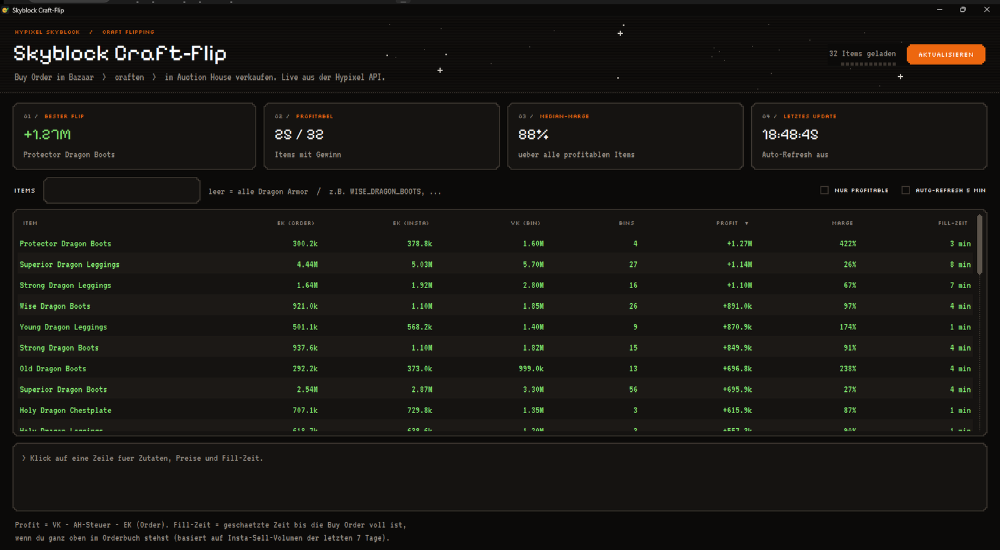

# Skyblock Craft-Flip

Findet profitable Craft-Flips in Hypixel Skyblock: Zutaten per **Bazaar Buy Order** kaufen, Item craften, im **Auction House** (BIN) verkaufen.



## Download

Die fertige `Skyblock-Flip.exe` gibt es unter [Releases](../../releases/latest). Einfach doppelklicken, kein Python und kein API-Key nötig.

> Windows SmartScreen warnt evtl. beim ersten Start (die Exe ist nicht signiert): **Weitere Informationen → Trotzdem ausführen**.

## Was es anzeigt

| Spalte | Bedeutung |
|---|---|
| EK (Order) | Kosten aller Zutaten, wenn du per Buy Order kaufst (höchste Order + 0.1) |
| EK (Insta) | Kosten beim Sofortkauf, zum Vergleich |
| VK (BIN) | Günstigstes Buy-It-Now-Angebot im Auction House |
| BINs | Anzahl BIN-Angebote (wenige = Preis unsicher) |
| Profit | VK − AH-Steuer − EK (Order) |
| Fill-Zeit | Geschätzte Zeit, bis die Buy Order voll ist, wenn du oben im Orderbuch stehst (Insta-Sell-Volumen der letzten 7 Tage) |

Standardmäßig werden alle 32 Dragon-Armor-Teile verglichen. Im Feld **Items** kannst du beliebige craftbare Item-IDs eingeben (z.B. `WISE_DRAGON_BOOTS, SUPERIOR_DRAGON_LEGGINGS`). Klick auf eine Zeile zeigt Zutaten, Preise und Konkurrenz im Orderbuch.

## Datenquellen

- Preise: [Hypixel API](https://api.hypixel.net/) (`/v2/skyblock/bazaar` und `/v2/skyblock/auctions`, öffentlich, kein Key)
- Rezepte: [NotEnoughUpdates-REPO](https://github.com/NotEnoughUpdates/NotEnoughUpdates-REPO)

## Aus dem Code starten

Nur Python 3 nötig, keine Pakete:

```bash
python skyblock_flip.py                              # GUI
python skyblock_flip.py --cli                        # Tabelle in der Konsole
python skyblock_flip.py --cli WISE_DRAGON_BOOTS      # bestimmte Items
```

Exe selbst bauen: `build.bat` (installiert PyInstaller und erzeugt `dist/Skyblock-Flip.exe`).

## Credits

Pixel-Fonts unter der SIL Open Font License (siehe `fonts/`): [Pixelify Sans](https://fonts.google.com/specimen/Pixelify+Sans), [Silkscreen](https://fonts.google.com/specimen/Silkscreen), [VT323](https://fonts.google.com/specimen/VT323).

Nicht mit Hypixel oder Mojang verbunden.
